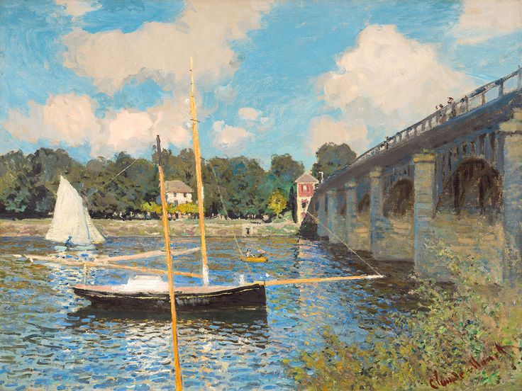

# Picture Animator

A C++ computer-graphics project that adds subtle motion to static pictures. Users select regions such as clouds, water, trees, and boats, then adjust wind speed and preview the animation through an OpenGL interface.

The original project follows the approach described in [Animating Pictures with Stochastic Motion Textures](http://grail.cs.washington.edu/projects/StochasticMotionTextures/) by Chuang et al.

## Example

<p>
  
  
</p>

These are the example assets already included in the repository.

## Technology

- C++14 and a Makefile-based build.
- OpenGL rendering with GLFW and the bundled gl3w loader.
- OpenCV for image selection, processing, and inpainting.
- Dear ImGui for the control panel.

## Build status and prerequisites

Use a C++14 compiler, Make, OpenGL development support, GLFW, OpenCV, and GLM headers. The Linux configuration looks up `glfw3` and `opencv4` through `pkg-config`.

```bash
git clone https://github.com/CaptainVish/Picture-Animator.git
cd Picture-Animator
```

Inspect [Makefile](Makefile) before building: its source lists contain inconsistent relative paths such as `../depends/`, `../../depends/`, and `.src/`, while the repository stores code in `depends/` and `src/`. The object rules and platform-specific include/link settings also need checking. The macOS section does not mirror the Linux OpenCV configuration.

After resolving those local build settings, the intended build command is:

```bash
make
```

Committed `main` and `objs/` files are old build artifacts, not portable release binaries. Build from source for your environment. A clean compile and graphical run were not performed during this README update.

## Run

Run from the repository root so shader and asset paths resolve. With a successfully built executable, use the bundled separated-image example:

```bash
./main -f background2.png -b boat2.png -t tree2.png -c cloud2.png -w water2.png
```

Or begin with your own image:

```bash
./main -f path/to/image.png
```

| Flag | Input |
| --- | --- |
| `-f` | Main/background image |
| `-b` | Boat image |
| `-c` | Cloud image |
| `-w` | Water image |
| `-t` | Tree image |

## Interactive controls

1. Select **Clouds**, **Water**, **Tree**, or **Boats** in the panel to open the corresponding selection window.
2. Draw over the region you want to segment. The original workflow uses `r` to reset, `s` to segment/inpaint, and `Esc` to close the selection window.
3. Use **Boat Point** or **Tree Point** to choose the transformation point where applicable.
4. Adjust **Wind Speed** and toggle **show** to preview the result.

The program writes working images such as `bg.png` into the current directory. Keep your input images backed up and use a working copy for experiments.

## Project map and credits

- `src/`: object behavior, image interaction, and application entry point.
- `shaders/`: vertex and fragment shaders.
- `depends/`: ImGui sources and backends.
- `libs/`: supporting graphics libraries/loaders and their notices.

The previous README linked its example assets to [CSE-333-Computer-Graphics-2020/Animating-Pictures](https://github.com/CSE-333-Computer-Graphics-2020/Animating-Pictures). That provenance is retained here; the previews above use this repository's local copies. Preserve the research attribution and bundled library license notices.
